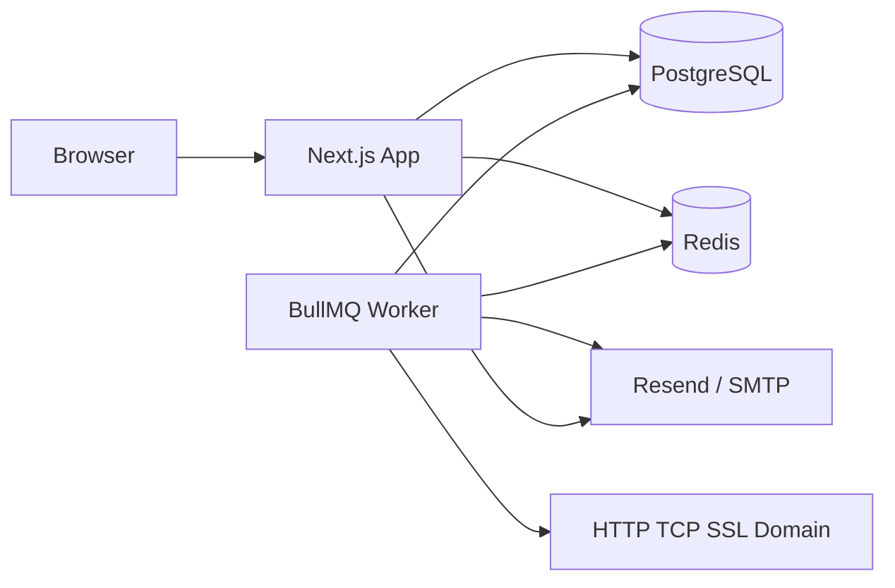

# Arquitetura — Energon Sentinel

## Visão geral

## Componentes

| Componente | Responsabilidade |
|------------|------------------|
| **web** | UI pt-BR, APIs REST, auth, cofre, dashboard |
| **worker** | Agenda e executa health checks, abre/fecha incidentes, e-mails de queda/recuperação/expiração, retenção |
| **postgres** | Fonte da verdade (projetos, credenciais cifradas, resultados, auditoria) |
| **redis** | Filas BullMQ |

## Decisões técnicas

1. **Next.js App Router (sem NestJS)** — painel interno com um único deploy; APIs em `app/api/**`.
2. **Prisma + PostgreSQL** — modelo relacional rico, migrations versionadas, seed demo.
3. **Worker separado (BullMQ)** — checks continuam se o painel reiniciar; jobs: `run-check`, `schedule-due` (30s), `expiry-alerts` (1h), `retention` (24h).
4. **Auth própria** — Argon2id + sessão em cookie (`energon_session`) com token hasheado no banco; 2FA TOTP obrigatório para `owner`.
5. **Cofre com envelope AES-256-GCM** — DEK aleatória por credencial; `MASTER_KEY` (env) cifra a DEK. Nunca logar plaintext.
6. **Anti-ruído** — incidente só após `failureThreshold` falhas consecutivas; e-mail só na transição (caiu/voltou) + lembrete periódico.
7. **DB monitoring** — preferir HTTP `/health` no backend; `db_ping`/`tcp` disponíveis quando necessário.
8. **Retenção** — `CheckResult` detalhado por `CHECK_RETENTION_DAYS` (30); depois agrega em `CheckResultDaily`.

## Modelo de dados (resumo)

- `Project` → `Service` → `Credential` / `HealthCheck`
- `HealthCheck` → `CheckResult` / `Incident`
- `User` → `Session` / `AlertRule` / `AuditLog`
- `NotificationLog` registra envios de e-mail

## Fluxo de um check

1. Worker (ou botão “Rodar agora”) chama `runHealthCheck`.
2. Executor HTTP/TCP/SSL/Domain retorna ok/falha + latência.
3. Persiste `CheckResult`, atualiza `consecutiveFails`.
4. Se cruzou threshold → cria `Incident` + e-mail “fora do ar”.
5. Se recuperou → fecha incidente + e-mail com duração.
6. Recalcula `Project.status` (operational / degraded / down / unknown).
7. Janela de manutenção silencia abertura de incidentes/e-mails.

## Segurança

- Rate limit + lockout em login
- Headers CSP / X-Frame-Options / nosniff
- Allowlist opcional de IPs (`ALLOWED_IPS`)
- Zod em rotas mutáveis
- Reauth fresco (5 min) para reveal/copy/export/import

## Extensões futuras

- Canais WhatsApp/Telegram: adicionar adapters ao lado de `lib/email.ts` e `channel` em `NotificationLog`
- KMS cloud no lugar de `MASTER_KEY` em env
